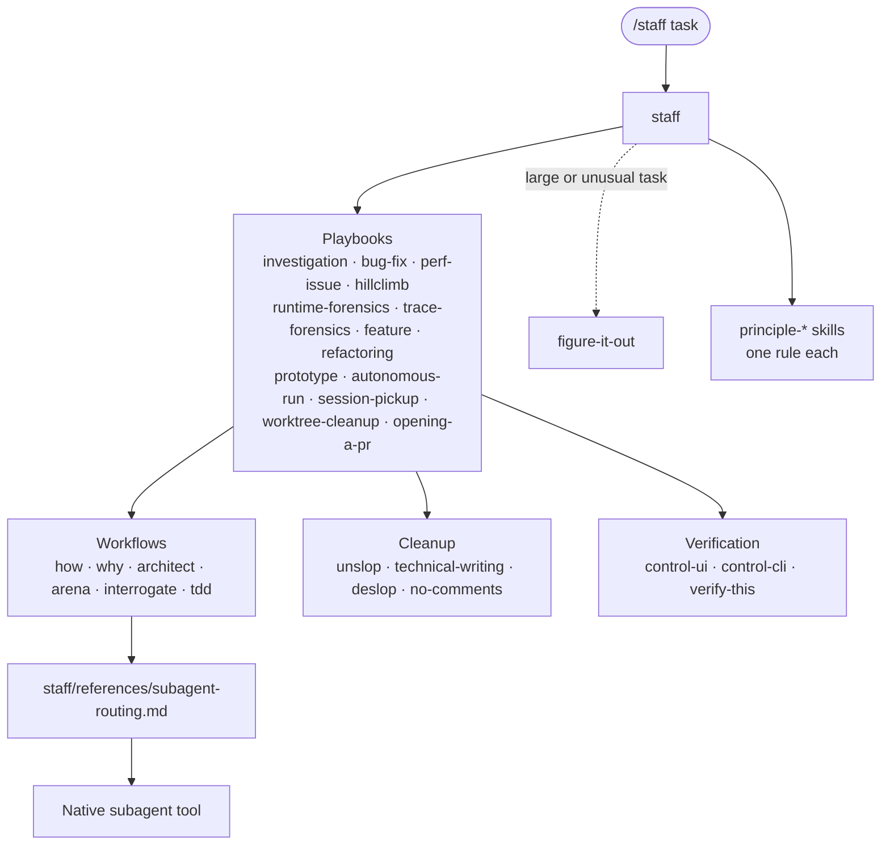
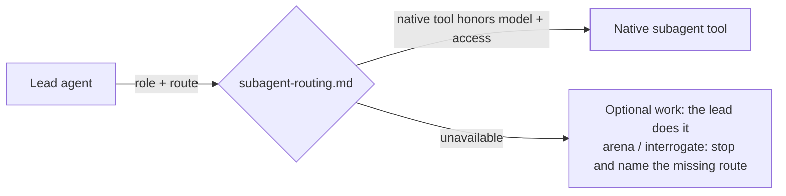

# lucastack

[Lucas](https://github.com/lucas-weng-appier) maintains this catalog of reusable
agent skills.

## Start here

Invoke `/staff` in Claude Code or `$staff` in Codex with your task. Staff
matches the task to a playbook, loads the principles that apply, and delegates
work to subagents. You rarely call the other skills yourself.

## How it fits together

Staff is the entry point. Its playbooks call workflow skills and cleanup
passes. Workflows delegate through the routing contract using the host's native
subagent tool.



### Example: `/staff login fails after restart`

```text
staff picks playbooks/bug-fix.md and copies its steps into a todo list
  loads principle-fix-root-causes and principle-prove-it-works
  1. reproduce the bug on the same surface (control-ui or control-cli)
  2. find the cause: how + why run as parallel subagents
  3. plan the fix (architect if it crosses a function boundary); a routed subagent implements it
  4. verify on the same surface as the repro
  5. commit the failing repro before the fix (tdd)
  6. open the PR: deslop, no-comments, technical-writing, unslop
```

### Who can invoke a skill

Most skills set `disable-model-invocation: true`. They run only when you type
the slash command or another skill names them. This keeps principles out of
the context window until a task needs them.

| Invoked by | Skills |
| --- | --- |
| You or another skill only | Every skill not listed in the next row |
| Also chosen automatically by the model | `unslop`, `deslop`, `technical-writing`, `skill-audit`, `create-jira-ticket`, `post-pending-review-comments`, `pr-author-context-comments`, `test-audit` |

## Skills

### Entry point

- [`staff`](staff/) applies the catalog's `principle-*` skills and routes work
  through the bundled
  [investigation](staff/playbooks/investigation.md),
  [bug fix](staff/playbooks/bug-fix.md),
  [perf issue](staff/playbooks/perf-issue.md),
  [hillclimb](staff/playbooks/hillclimb.md),
  [runtime forensics](staff/playbooks/runtime-forensics.md),
  [trace forensics](staff/playbooks/trace-forensics.md),
  [feature](staff/playbooks/feature.md),
  [refactoring](staff/playbooks/refactoring.md),
  [prototype](staff/playbooks/prototype.md),
  [autonomous run](staff/playbooks/autonomous-run.md),
  [session pickup](staff/playbooks/session-pickup.md),
  [worktree cleanup](staff/playbooks/worktree-cleanup.md), and
  [opening a PR](staff/playbooks/opening-a-pr.md) playbooks.

### Workflows

Staff playbooks call these skills. You can also invoke them directly.

- [`architect`](architect/) sketches types and module boundaries before
  implementation, then keeps the design in the implementation loop.
- [`arena`](arena/) runs parallel candidates, selects a base, and combines the
  strongest parts into one verified result.
- [`figure-it-out`](figure-it-out/) designs an auditable playbook for large
  migrations, ambitious multi-part changes, or work a human reviews after
  stepping away.
- [`how`](how/) explains subsystem architecture and runtime flow through
  focused code exploration.
- [`interrogate`](interrogate/) runs a multi-model adversarial code review and
  synthesizes the findings into a lead verdict.
- [`show-me-your-work`](show-me-your-work/) records a reviewable TSV decision
  trail for long-running or unattended work.
- [`tdd`](tdd/) runs a failing-test-first bug-fix workflow when a focused
  regression test is practical.
- [`why`](why/) investigates the historical evidence behind code decisions and
  reports what is known, inferred, and still unknown.

### Principles

Each principle skill holds one rule. Staff loads a principle when its
situation matches, and cites only the principles it read. The groups match the
sections in [`staff/SKILL.md`](staff/SKILL.md).

**Core**

- [`principle-attack-the-premise`](principle-attack-the-premise/) questions a
  shared premise after repeated fixes fail the same gate.
- [`principle-build-the-lever`](principle-build-the-lever/) turns non-trivial
  work into a rerunnable script, generator, check, or skill.
- [`principle-exhaust-the-design-space`](principle-exhaust-the-design-space/)
  compares concrete prototypes before committing to a novel design.
- [`principle-experience-first`](principle-experience-first/) resolves product
  and implementation tradeoffs in favor of the user's experience.
- [`principle-foundational-thinking`](principle-foundational-thinking/) puts
  data structures, shared-state decisions, and reusable setup first.
- [`principle-laziness-protocol`](principle-laziness-protocol/) favors deletion,
  flat call paths, and the smallest sufficient change.
- [`principle-minimize-reader-load`](principle-minimize-reader-load/) reduces
  indirection and the amount of mutable state a reader must track.
- [`principle-outcome-oriented-execution`](principle-outcome-oriented-execution/)
  prioritizes a verified migration end state over temporary compatibility code.
- [`principle-redesign-from-first-principles`](principle-redesign-from-first-principles/)
  integrates a new requirement as though it were part of the original design.
- [`principle-subtract-before-you-add`](principle-subtract-before-you-add/)
  removes obsolete complexity before adding new behavior.

**Architecture**

- [`principle-boundary-discipline`](principle-boundary-discipline/) keeps
  validation and error handling at system boundaries.
- [`principle-make-operations-idempotent`](principle-make-operations-idempotent/)
  makes repeated or interrupted operations converge on one end state.
- [`principle-migrate-callers-then-delete-legacy-apis`](principle-migrate-callers-then-delete-legacy-apis/)
  removes an internal legacy API in the same change that migrates its callers.
- [`principle-model-the-domain`](principle-model-the-domain/) replaces scattered
  branches and shape assumptions with domain-specific structures.
- [`principle-separate-before-serializing-shared-state`](principle-separate-before-serializing-shared-state/)
  removes shared write targets before adding concurrency controls.
- [`principle-type-system-discipline`](principle-type-system-discipline/) uses
  types to exclude invalid states and expose unhandled variants.

**Verification**

- [`principle-fix-root-causes`](principle-fix-root-causes/) traces symptoms to
  their source before changing code.
- [`principle-prove-it-works`](principle-prove-it-works/) verifies completed work
  against the real artifact instead of a proxy.
- [`principle-sequence-verifiable-units`](principle-sequence-verifiable-units/)
  breaks multi-step work into checked units and orders delivery as evidence.
- [`principle-test-behavior-not-implementation`](principle-test-behavior-not-implementation/)
  tests observable results through the same interface that users call.

**Delegation**

- [`principle-guard-the-context-window`](principle-guard-the-context-window/)
  limits unnecessary reads and keeps large payloads out of the main context.
- [`principle-never-block-on-the-human`](principle-never-block-on-the-human/)
  proceeds with reversible work and reserves questions for genuine ambiguity.

**Meta**

- [`principle-encode-lessons-in-structure`](principle-encode-lessons-in-structure/)
  replaces repeated instructions with enforceable mechanisms.

### Cleanup passes

- [`deslop`](deslop/) removes AI-generated code patterns while preserving
  behavior and local style.
- [`no-comments`](no-comments/) audits comments, removes accepted clutter, and
  reports constraints that need structural fixes.
- [`technical-writing`](technical-writing/) applies Diátaxis, Google developer
  style, Simplified Technical English, and Global English to technical prose.
- [`typescript-best-practices`](typescript-best-practices/) applies the catalog's
  type-system and boundary principles to TypeScript code.
- [`unslop`](unslop/) removes common AI writing patterns while preserving the
  meaning and tone.

### Verification harnesses

Staff calls a control skill to reproduce a bug or check a change on the
surface that users see. You can also invoke these skills directly.

- [`control-cli`](control-cli/) builds or reuses a local tmux or PTY harness to
  drive, inspect, and profile an interactive CLI or TUI.
- [`control-ui`](control-ui/) builds or reuses a local browser or CDP harness to
  drive, screenshot, and profile a web, IDE, or Electron UI.
- [`verify-this`](verify-this/) tests one falsifiable claim against a baseline
  and a treatment, then returns `VERIFIED`, `NOT VERIFIED`, or `INCONCLUSIVE`.

### Standalone tools

- [`bro`](bro/) restates the last message in simpler language without jargon.
- [`create-jira-ticket`](create-jira-ticket/) creates or updates concise Jira
  tickets from specs, related issues, pull requests, or user notes.
- [`post-pending-review-comments`](post-pending-review-comments/) writes
  validated findings to an unsubmitted GitHub review and verifies the result.
- [`pr-author-context-comments`](pr-author-context-comments/) explains
  non-obvious author decisions at their exact PR diff locations.
- [`recall`](recall/) rebuilds your recent working context from Claude Code and
  Codex transcripts, live state, and the shared record.
- [`show-me`](show-me/) explains the current topic with concise diagrams,
  code-shape sketches, and focused HTML artifacts.
- [`skill-audit`](skill-audit/) reviews a skill's triggering, target mechanics,
  and instruction fitness without editing the skill.
- [`teach`](teach/) runs `how` and `why` and combines their findings into one
  plain explanation of a change or subsystem.
- [`test-audit`](test-audit/) gates new tests against a value bar and prunes
  low-value, duplicative, or implementation-coupled tests.

## Delegation requirements

`staff`, `how`, `why`, `arena`, and `interrogate` delegate work to other
agents. The [staff routing contract](staff/references/subagent-routing.md)
selects the control method, the model route, the access mode, and the child
prompt.



Delegation requires a native subagent tool that supports the requested model,
reasoning effort, access mode, and working directory. If those controls are
unavailable, follow the routing contract's fallback.

Model access depends on the local provider configuration. Accepting a model setting
alone does not prove that a model can answer requests. When a route is
unavailable, `arena` and `interrogate` stop instead of replacing independent
review with the lead agent's own opinion.

## Sources

- `bro` comes from [Dillon Mulroy's X post][bro-x].
- `control-cli`, `control-ui`, `deslop`, and `verify-this` come from
  [Cursor's `cursor-team-kit` plugin][cursor-team-kit].
- `show-me` comes from [HumanLayer's skill catalog][humanlayer-show-me].
- `test-audit` comes from [OpenClaw's repository skills][openclaw-test-audit].
- `arena`, `architect`, `figure-it-out`, `how`, `interrogate`, `no-comments`,
  the `principle-*` skills, `recall`, `show-me-your-work`, `tdd`, `teach`, `technical-writing`,
  `typescript-best-practices`, `unslop`, and `why` come from
  [pstack's skill catalog][pstack-principles]. `recall` and `teach` come from a
  [later pstack revision][pstack-teach].

[cursor-team-kit]: https://github.com/cursor/plugins/tree/12d587dfb20741cafc376c42c696c5f6e2a64487/cursor-team-kit/skills
[bro-x]: https://x.com/dillon_mulroy/status/2079238358358778142
[humanlayer-show-me]: https://github.com/humanlayer/skills/blob/bba9d13ab34f0a87f1cc33df4dd196372393ddfc/plugins/show-me/skills/show-me/SKILL.md
[openclaw-test-audit]: https://github.com/openclaw/openclaw/blob/792907dce5f2264b79a92d96fb4d0bf1fbd6c5d2/.agents/skills/test-audit/SKILL.md
[pstack-teach]: https://github.com/cursor/plugins/tree/ecc249f1e306fc64ddf83c7bed16cacf7c2239db/pstack/skills
[pstack-principles]: https://github.com/cursor/plugins/tree/5bf2b1544db739998121a306340631963c2ff3de/pstack/skills
