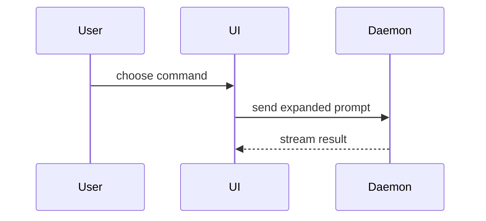

Help the user understand the current topic of conversation visually. Skip the preamble and keep prose brief. Pick the smallest view that makes the key point clear.

For a saved HTML or image deliverable, use [Task files and cleanup](../staff/playbooks/task-artifacts.md). Keep the final requested view in the task archive and intermediate rendering files in scratch. Inline-only explanations need no archive.

- Show logic or an algorithm as pseudocode:

```text
on(save)
  if content is unchanged
    return cached result
  write new content
  return fresh result
```

- Show runtime control flow as a call tree:

```text
submitForm
  createSession
    persistPrompt
    launchAgent
  navigateToSession
```

- Show UI structure as a component tree, including state and module boundaries that matter:

```tsx
<SessionPage> (apps/example/src/routes/session.tsx)
  useSessionEvents()
  <SessionToolbar>
    <RunSkillButton> (packages/ui)
```

- Show file responsibility or a broad refactor as a shallow file tree:

```text
src/
├── commands/       # parses user actions
├── sessions/       # owns session state
└── transport/      # sends API requests
```

- Show component interaction, control flow, or data flow with Mermaid:



- Use `diff` when the point is what changes and the surrounding shape already exists. Match the diff shape to the topic.

For a component change:

```diff
 <SessionPage>
   useSessionEvents()
   <SessionToolbar>
+    <RunSkillButton />
   <SessionTimeline>
+    <SkillResultCard />
```

For a file-layout change:

```diff
 src/
 ├── commands/
+│   └── show-me.ts       # expands the slash command
 ├── sessions/
-└── transport.ts
+└── transport/
+    ├── client.ts
+    └── stream.ts
```

For a call-tree or call-stack change:

```diff
 submitForm
   createSession
     persistPrompt
+    expandSkillMention
     launchAgent
-  navigateToSession
+  navigateToSession
+    subscribeToEvents
```

For a state or control-flow change:

```diff
 on(save)
-  write content
+  if content is unchanged
+    return cached result
+  write new content
+  invalidate cache
```

- Show the whole block when most of it is new, when omitted context would hide ownership or order, or when the user needs a copyable target shape:

```ts
function expandSkill(command: string): string {
  const skillName = command.slice(1)
  return `use the ${skillName} skill`
}
```

- For a visual UI, layout, state comparison, or concept too dense for Mermaid, write one focused HTML file. Choose a diagram, an infographic, or a short slide deck based on the point. Match the product's colors, type, spacing, and components. Use real labels and data, and support desktop and mobile. Then open it for the user. In Codex, open it in the file viewer. In Claude Code, run `open path/to/file.html` on macOS or `xdg-open path/to/file.html` on Linux.

### Guidance

Place each visual next to the short text it supports. Keep only the calls, files, props, states, and boundaries needed to answer the user's current question or the options to resolve the current discussion point.

Use only the views needed to explain the current question.

### Evidence-report mode

When a caller supplies verification results and requests a report, use those
results as the source of truth. Preserve every supplied AC or claim, verdict,
coverage mode, observation, evidence reference and limitation. Missing evidence
stays visibly missing; layout does not establish a passing verdict.

Honor the caller's required evidence format and per-AC mapping. For screenshot
reports, embed the supplied actual captures beside their AC and scenario labels,
retaining revision, role and coverage context. Mark missing, unreadable or
mismatched captures `證據未完成` at the affected AC and in the summary. Keep the
behavioral verdict separate from evidence completeness. Text, API responses,
diagrams, recreated UI and screenshots of those substitutes cannot fill a
required actual-app screenshot slot. Return missing capture requests to the
verification owner; presentation must not fabricate or relabel evidence.

Honor the caller's output path and format. For a GCS verification report, produce
one self-contained `index.html`: inline CSS and any JavaScript, embed images as
data URLs, and use in-page anchors for sections. Keep the summary easy to scan
and place evidence beside its claim. Use text safely as text, not executable
HTML. The report must render without external assets or local filesystem paths.

Check the rendered result through **control-ui**, including embedded images and
narrow layouts. Return the local file to the caller. The caller owns upload and
Jira publication; this mode creates no separate verification or publishing flow.
